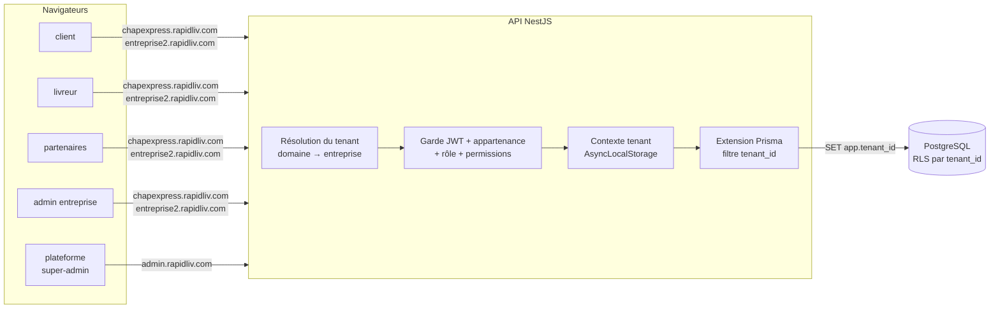
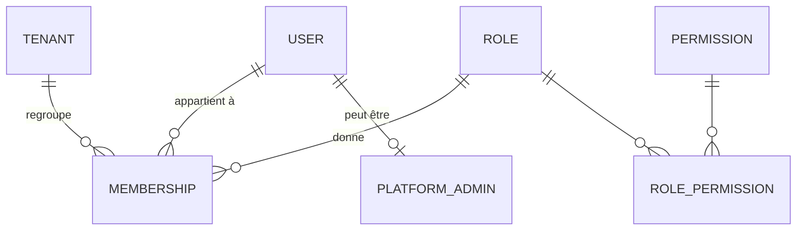
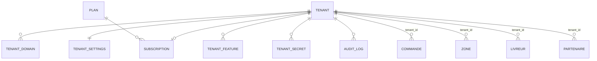

# Évolution multi-entreprises — audit et architecture cible

> Phases 1 (audit) et 2 (architecture cible) du chantier « plateforme
> multi-entreprises ». Rien n'est implémenté : ce document sert à valider la
> direction avant le plan de migration (phase 3). Rédigé le 04/11/2026 à partir
> du code de `main` (commit `de79170`).
>
> La marque technologique s'appelle
> **RapidLiv** (décision du 04/11, § 6) ; le domaine `rapidliv.com` est une hypothèse de travail.

## Résumé

L'application est un monorepo NestJS + Prisma/PostgreSQL + 4 PWA React,
propre et bien découpé par service (Repas, Colis, Courses express, Emplettes).
Elle est **mono-entreprise par construction** : aucune table ne porte
d'entreprise, plusieurs contraintes d'unicité sont globales (téléphone, nom de
zone, nom de quartier), et la configuration métier (services ouverts, modes de
paiement, commission de 15 %, comptes FedaPay/Twilio/Cloudinary) est globale,
en variables d'environnement ou en constantes compilées.

La recommandation est une **base unique, schéma unique, colonne
`tenant_id` sur chaque table métier**, avec **deux barrières d'isolation
indépendantes** : un filtre automatique dans l'API (extension Prisma alimentée
par le contexte de la requête) et la **Row-Level Security de PostgreSQL**. Les
4 apps restent **un seul build chacune**, qui prend l'identité visuelle et les
fonctionnalités de l'entreprise à l'exécution, d'après le sous-domaine. Une
5ᵉ app, `plateforme`, porte l'administration centrale.

CHAP EXPRESS devient le tenant n°1 : une migration crée l'entreprise, rattache
toutes les lignes existantes, puis rend la colonne obligatoire. Aucune donnée
n'est déplacée ni réécrite, seulement étiquetée.

Décisions prises le 04/11 : voir
[§ 6](#6-points-à-arbitrer).

---

## 1. Audit de l'existant

### 1.1 Stack et structure

| Couche | Technologie | Emplacement |
|---|---|---|
| API | NestJS 11, Prisma 7, PostgreSQL 16 | `apps/api` — 25 contrôleurs, 20 modules |
| Temps réel | Socket.IO, une room par utilisateur | `apps/api/src/realtime` |
| Apps | React + Vite + TanStack Query + Zustand, PWA | `apps/client`, `apps/livreur`, `apps/partenaires`, `apps/admin` |
| Partagé | Thème Tailwind, identité visuelle, périmètre V1, types | `packages/config` |
| Hébergement | Render (API + 4 sites statiques) + Neon ; alternative Docker + Caddy | `render.yaml`, `deploy/` |

Le monorepo est déjà organisé « un code pour tous » : rien n'est dupliqué par
entreprise, ce qui rend l'évolution multi-tenant possible sans refonte.

### 1.2 Fonctionnalités en place

| Domaine | Ce qui existe | Modules |
|---|---|---|
| Commandes | 4 services, chacun avec sa machine à états ; commande invitée (sans compte) | `commandes-*`, `invite` |
| Livreurs | Courses à prendre/attribuées, hors ligne, portefeuille, clôture de caisse | `livreurs`, `portefeuille` |
| Restaurants | Menu, commandes cuisine, ouverture, ventes | `restaurants` |
| Back-office | Vue d'ensemble, dispatch auto + manuel, livreurs, zones, quartiers, restaurants, remboursements, saisie manuelle, tableau de bord | `admin` (55 accès base) |
| Tarification | Prix par quartier (RG-08), grilles Colis et Courses express par zone | `quartiers`, `zones` |
| Paiement | FedaPay (page hébergée + webhook signé), remboursements manuels | `paiements` |
| Notifications | Web Push (VAPID) + WhatsApp/SMS (Twilio, pilote console), e-mail | `notifications` |
| Médias | Upload direct signé Cloudinary | `medias` |
| Avis | Notation restaurant et livreur | `notations` |

### 1.3 Modèle de données

26 modèles, 15 énumérations, 25 migrations. Aucun ne référence une
entreprise. Répartition selon ce qu'ils deviendront :

| Nature | Modèles |
|---|---|
| **Globaux** (restent partagés) | `Role`, `Permission`, `RolePermission`, `OtpCode` |
| **Identité** (à scinder : personne globale + appartenance à une entreprise) | `User` |
| **Métier racine** (reçoivent `tenant_id`) | `Zone`, `Quartier`, `Partenaire`, `Livreur`, `Commande`, `Adresse`, `AbonnementPush` |
| **Métier enfant** (reçoivent `tenant_id` dénormalisé pour la RLS) | `Plat`, `CommandeRepas`, `LigneCommandeRepas`, `CommandeColis`, `CommandeEmplettes`, `ArticleEmplette`, `CommandeCoursesExpress`, `EtapeCourseExpress`, `Paiement`, `Notation`, `MouvementPortefeuille`, `ClotureCaisse`, `GrilleTarifaireColis`, `GrilleTarifaireCoursesExpress` |

**Contraintes d'unicité qui bloquent plusieurs entreprises :**

| Contrainte actuelle | Problème | Cible |
|---|---|---|
| `users.telephone` unique | Un même numéro (client, livreur) ne peut exister que dans une entreprise | Reste unique **si** identité globale (voir [Q-MT-2](#6-points-à-arbitrer)) |
| `users.email` unique | Idem | Idem |
| `zones.nom` unique | Deux entreprises ne peuvent pas avoir une zone « Centre-ville » | `(tenant_id, nom)` |
| `quartiers.nom` unique | Deux entreprises d'une même ville ne peuvent pas lister le même quartier | `(tenant_id, nom)` |
| `roles.name` unique | Aucun : les rôles restent un catalogue global | — |

### 1.4 Authentification et permissions

- Jeton JWT `{ sub, role }`, durée 2 h, mot de passe ou OTP par SMS/WhatsApp.
- `JwtAuthGuard` **global, refus par défaut** (`@Public()` explicite) : bon
  point de départ, une route oubliée est fermée, pas ouverte.
- Le rôle et les permissions sont **relus en base à chaque requête** : un
  changement de rôle prend effet sans attendre l'expiration du jeton. C'est
  là que se brancheront l'entreprise et l'appartenance.
- `RolesGuard` vérifie `@Roles(...)` puis `@RequirePermissions(...)`.
  Seul `admin_dispatcher` porte des permissions aujourd'hui.
- Rôles existants : `client`, `restaurant`, `livreur`, `admin_dispatcher`.
  Il n'y a ni super-admin ni administrateur d'entreprise distinct du
  dispatcher.

**Routes publiques**, qui devront connaître l'entreprise **sans jeton**,
d'après le domaine appelant :

| Route | Usage |
|---|---|
| `GET /restaurants`, `GET /restaurants/:id`, `GET /quartiers`, `GET /zones` | Catalogue et prix visibles avant connexion |
| `POST /auth/login`, `/auth/register`, `/auth/otp/*` | Connexion et inscription |
| `/invite/*` | Commande et suivi sans compte |
| `GET /commandes-colis/suivi/:id` | Suivi public d'un colis |
| `POST /paiements/fedapay` | Webhook : l'entreprise se déduit de la transaction, pas du domaine |
| `GET /medias/config`, `POST /medias/signature`, `GET /notifications/cle-publique`, `GET /health` | Techniques |

### 1.5 Configuration globale et intégrations

Tout ce qui suit est aujourd'hui **une valeur pour toute l'application** et
devra pouvoir varier par entreprise :

| Élément | Où | Commentaire |
|---|---|---|
| Services ouverts, modes de paiement | `SERVICES_ACTIFS` / `MODES_PAIEMENT_ACTIFS` (env API) + constantes compilées `packages/config/perimetre-v1.ts` | Les constantes front sont éliminées au build : impossible de varier par entreprise sans passer à une config lue à l'exécution |
| Commission de service 15 % | En dur, `commandes-repas.service.ts:207` (et `CartPage` côté client) | Règle financière : chaque entreprise fixera la sienne |
| Compte FedaPay | `FEDAPAY_*` (env) | Qui encaisse ? Voir [Q-MT-4](#6-points-à-arbitrer) |
| Twilio (SMS/WhatsApp), expéditeur e-mail | `MESSAGERIE_*`, `COURRIEL_*` (env) | Texte des messages en dur : « Votre code ChapExpress… » |
| Cloudinary | env, dossier `chapexpress/*` | Dossier par entreprise suffit |
| VAPID (Web Push) | env, sujet `mailto:contact@chapexpress.bj` | Peut rester global |
| CORS | `CORS_ORIGINS`, liste fixe de 4 domaines | Doit accepter `*.rapidliv.com` et les domaines personnalisés enregistrés |

### 1.6 Dépendances à CHAP EXPRESS dans le code

| Type | Volume | Exemples |
|---|---|---|
| Nom « ChapExpress » | 107 occurrences (API 48, client 21, partenaires 14, admin 14, livreur 10) | SMS OTP, notifications, en-têtes, manifestes PWA, titres de page |
| Ville | 17 occurrences de « Natitingou » | Titres, aides, placeholders |
| Monnaie, fuseau, indicatif | ~100 occurrences de `FCFA`, `Africa/Porto-Novo`, `+229` | Formatage des prix et des dates, validation du téléphone |
| Contacts | Numéro WhatsApp support en dur (`apps/client/src/lib/support.ts`), `contact@chapexpress.bj` | |
| Identité visuelle | `packages/config/marque.css`, logos dans `apps/*/public` | Déjà centralisée en tokens CSS : facile à surcharger à l'exécution |
| Règles métier | RG-01 à RG-14 (`docs/regles-gestion.md`), commission, plafonds livreur | Rédigées pour CHAP EXPRESS ; certaines devront devenir des paramètres d'entreprise |

Il n'y a **aucune** donnée CHAP EXPRESS en dur dans les requêtes : le
couplage est dans les textes, la configuration et les contraintes d'unicité,
pas dans la logique.

### 1.7 Exploitation, sauvegardes, tests

- **Sauvegardes** : `deploy/sauvegarde.sh` fait un `pg_dump` quotidien de
  toute la base, conservé 14 jours. Neon offre en plus la restauration à un
  instant donné. Aucune sauvegarde ni restauration **par entreprise**.
- **Journaux** : pas de journal d'activité. Les actions sensibles laissent
  une trace partielle dans les données (`annuleePar`, `saisiePar`,
  `rapprocheePar`, `confirmePar`) mais rien de centralisé ni de consultable.
- **Tests** : 12 fichiers de tests unitaires API, 5 suites e2e (27 cas : un
  parcours complet par service), 14 fichiers de tests front. Aucun test
  d'autorisation entre utilisateurs de même rôle. C'est la lacune à combler
  en priorité avec le multi-tenant.

### 1.8 Constats et risques

1. **Accès base dispersés** : ~200 appels Prisma répartis dans 17 modules,
   dont 32 transactions. Ajouter un `where: { tenantId }` à la main sur
   chacun serait long et surtout fragile : un oubli suffit à exposer les
   données d'une autre entreprise. D'où le filtre automatique **et** la RLS.
2. **Deux requêtes SQL brutes** (`$queryRaw`, `$executeRaw`) échappent à tout
   filtre Prisma : à revoir une par une, et couvertes par la RLS.
3. **Le webhook FedaPay** arrive sans domaine d'entreprise : il faut
   retrouver l'entreprise par la référence de transaction, et vérifier la
   signature avec la clé **de cette entreprise** si les comptes sont séparés.
4. **Les PWA sont déjà installées** chez les utilisateurs CHAP EXPRESS sur
   leurs domaines actuels : ces domaines doivent continuer à servir CHAP
   EXPRESS sans réinstallation (domaines personnalisés, § 2.3).
5. **Le dispatcher actuel** (`admin_dispatcher`) mélange administration
   d'entreprise et opérations. Il devient « administrateur d'entreprise » de
   CHAP EXPRESS ; un rôle « gestionnaire » plus restreint s'ajoute.
6. **Le rôle `restaurant`** n'apparaît pas dans votre liste de rôles mais
   existe et doit rester : je l'appelle « partenaire » ci-dessous.

---

## 2. Architecture cible

### 2.1 Choix de l'isolation

| Option | Pour | Contre | Verdict |
|---|---|---|---|
| Une base par entreprise | Isolation physique maximale | Migrations × N, connexions × N, incompatible avec l'offre Neon gratuite, statistiques globales difficiles | Écartée pour l'instant |
| Un schéma PostgreSQL par entreprise | Bonne isolation | Prisma gère mal le changement de schéma dynamique, migrations × N | Écartée |
| **Schéma partagé + `tenant_id` + RLS** | Une migration pour tous, statistiques globales simples, Prisma natif, coût nul | L'isolation dépend du code **et** de la base : il faut les deux barrières et des tests | **Recommandée** |

Une entreprise qui exigerait plus tard une base dédiée (contrat, volume)
pourra être extraite : le `tenant_id` sur chaque ligne rend l'export trivial.

### 2.2 Vue d'ensemble



### 2.3 Résolution de l'entreprise

1. **Par le domaine** : chaque requête porte un en-tête `X-Tenant` ajouté
   par les apps, d'après `location.hostname` (`chapexpress.rapidliv.com`,
   `livreur.chapexpress.rapidliv.com`…). L'API le vérifie contre la table
   `tenant_domains`, qui accepte aussi les **domaines personnalisés**, dont
   les domaines CHAP EXPRESS actuels.
2. **Par le jeton** : le JWT porte `tid` (l'entreprise de la session). Si
   `tid` ≠ entreprise du domaine, la requête est **refusée** (403, et
   journalisée comme événement de sécurité). Un jeton d'une entreprise est
   inutilisable sur une autre.
3. **Routes publiques** : l'entreprise vient du domaine seul.
4. **Webhooks et tâches de fond** : l'entreprise vient de la donnée
   (transaction FedaPay → paiement → `tenant_id`), jamais d'un en-tête.
5. **Super-admin** : routes `/plateforme/*` sur `admin.rapidliv.com`, sans
   contexte d'entreprise. Il n'agit sur une entreprise que par des routes
   dédiées, journalisées. Pas d'« usurpation » silencieuse.

### 2.4 Isolation dans l'API — deux barrières

**Barrière 1, applicative.** Un `TenantContext` (AsyncLocalStorage) est
rempli par un intercepteur global après authentification. Une **extension
Prisma** ajoute automatiquement `tenantId` :

- en lecture (`findMany`, `findFirst`, `count`, `aggregate`, `groupBy`) :
  `where: { AND: [where, { tenantId }] }` ;
- en écriture (`create`, `createMany`, `upsert`) : `data.tenantId = tenantId` ;
- `findUnique` par identifiant : remplacé par `findFirst` filtré, pour qu'un
  identifiant d'une autre entreprise donne « introuvable » et non la donnée.

Une requête sur un modèle métier **sans** contexte d'entreprise lève une
erreur : l'oubli est bruyant, jamais silencieux. Les rares accès
transverses (super-admin, statistiques globales) passent par un client
Prisma distinct et explicitement nommé (`prismaPlateforme`).

**Barrière 2, base de données.** Sur chaque table métier :

```sql
ALTER TABLE commandes ENABLE ROW LEVEL SECURITY;
ALTER TABLE commandes FORCE ROW LEVEL SECURITY;
CREATE POLICY isolation_tenant ON commandes
  USING (tenant_id = current_setting('app.tenant_id', true))
  WITH CHECK (tenant_id = current_setting('app.tenant_id', true));
```

L'API se connecte avec un rôle PostgreSQL **sans** `BYPASSRLS`. L'extension
Prisma exécute `SELECT set_config('app.tenant_id', $1, true)` dans la même
transaction que la requête. Même un `$queryRaw` oublié ou un bug de
l'extension ne peut pas lire une autre entreprise. Le client
`prismaPlateforme` utilise un rôle distinct, réservé aux routes
super-admin.

La RLS arrive **après** l'extension (§ 4) : elle se teste plus facilement
quand le filtre applicatif est déjà en place.

### 2.5 Identité, appartenance et rôles



- `User` reste **la personne** : téléphone, nom, mot de passe, OTP. Unique
  sur toute la plateforme (recommandé, voir [Q-MT-2](#6-points-à-arbitrer)).
- `Membership (user_id, tenant_id, role_id, statut)` : ce que la personne
  **est dans une entreprise**. Le rôle quitte `User` pour `Membership`.
- `Livreur`, `Partenaire`, `Adresse` portent `tenant_id` : un livreur qui
  travaillerait pour deux entreprises aurait deux fiches (portefeuille et
  caisse séparés), une par entreprise.
- `PlatformAdmin (user_id)` : super-administrateurs, hors entreprise.

| Rôle | Portée | Aujourd'hui |
|---|---|---|
| `super_admin` | Plateforme | — (nouveau) |
| `admin_entreprise` | Une entreprise, tout | `admin_dispatcher` (migré tel quel) |
| `gestionnaire` | Une entreprise, opérations sans paramètres ni finances | — (nouveau, permissions déjà prévues pour ça) |
| `livreur` | Ses courses dans son entreprise | `livreur` |
| `partenaire` | Son restaurant / commerce | `restaurant` |
| `client` | Ses commandes dans l'entreprise du domaine | `client` |

Les rôles et permissions restent un **catalogue global** défini par la
plateforme. Une entreprise attribue des rôles mais n'en crée pas en V1 :
moins de surface de sécurité, et suffisant pour les besoins décrits.

### 2.6 Modèle de données — ajouts



| Table | Contenu |
|---|---|
| `tenants` | `id`, `slug` (`chapexpress`), `nom`, `statut` (`actif`, `suspendu`, `resilie`), dates |
| `tenant_domains` | `domaine` unique, `tenant_id`, `principal`, `verifie_at` |
| `tenant_settings` | Nom commercial, logo, couleurs (`primary`, `navy`, `accent`), contacts (téléphone, WhatsApp, e-mail), ville, pays, devise, fuseau, indicatif, taux de commission, textes des SMS |
| `tenant_features` | `tenant_id`, `code` (`service.repas`, `paiement.especes`…), `actif` ; remplace `SERVICES_ACTIFS` et les constantes V1 |
| `plans`, `subscriptions` | Offre, fonctionnalités incluses, période, statut. Simple, sans facturation automatique en V1 |
| `tenant_secrets` | Identifiants FedaPay, Twilio… **chiffrés** (AES-GCM, clé maîtresse en variable d'environnement), jamais renvoyés en clair |
| `memberships` | Voir § 2.5 |
| `platform_admins` | Voir § 2.5 |
| `audit_logs` | `tenant_id` (nul pour la plateforme), acteur, action, cible, avant/après (JSON), IP, date. Append-only |

Toutes les tables métier de § 1.3 reçoivent `tenant_id` (index, clé
étrangère vers `tenants`), et les unicités de § 1.3 deviennent composites.

### 2.7 Les apps

- **client, livreur, partenaires, admin** : un seul build chacune, servi sur
  `*.rapidliv.com` et les domaines personnalisés. Au démarrage, l'app
  appelle `GET /api/tenant` (public, d'après le domaine) et reçoit nom,
  logo, couleurs, contacts, ville, devise et fonctionnalités. Elle applique
  les couleurs en surchargeant les variables CSS de `marque.css` : le
  système visuel actuel est déjà fait pour ça. Ces réglages sont mis en cache
  hors ligne (le livreur en a besoin).
- **Manifeste PWA** : servi dynamiquement par l'API
  (`/api/tenant/manifest.webmanifest`) pour que l'icône et le nom installés
  soient ceux de l'entreprise.
- **Fonctionnalités** : `perimetre-v1.ts` reste le **plafond technique**
  (ce qui est développé) ; `tenant_features` décide ce qui est ouvert pour
  chaque entreprise, des deux côtés (API et apps).
- **`admin`** devient l'espace de gestion de l'entreprise : on y ajoute
  paramètres, identité visuelle, utilisateurs et rôles, journal.
- **`plateforme`** (nouvelle app, même stack et mêmes composants) :
  entreprises, domaines, offres et abonnements, fonctionnalités, statistiques
  globales, journal et événements de sécurité.
- **Hébergement** : les sites statiques Render acceptent des domaines
  personnalisés, mais les sous-domaines génériques (`*.rapidliv.com`)
  demandent une offre payante ou un passage par Caddy (déjà prévu dans
  `deploy/`), qui gère les certificats à la demande. À trancher avec le choix
  d'hébergement ([Q-MT-6](#6-points-à-arbitrer)).

### 2.8 Journal d'activité et sécurité

- Un intercepteur global écrit dans `audit_logs` toute requête qui modifie
  des données (POST, PATCH, PUT, DELETE), avec l'acteur, l'entreprise et la
  cible. Les actions sensibles déjà tracées (annulation, remboursement,
  rapprochement) ajoutent l'avant/après.
- **Événements de sécurité**, avec `tenant_id` nul ou celui de l'entreprise
  visée : échecs de connexion répétés, OTP brûlés, jeton présenté sur le
  mauvais domaine, accès refusé à une route plateforme.
- Consultables par l'admin d'entreprise (ses lignes) et le super-admin (tout).

### 2.9 Sauvegardes et restauration

- Le `pg_dump` quotidien global et la restauration à un instant donné de
  Neon restent la base (sinistre complet).
- **Export par entreprise** : script qui extrait toutes les lignes d'un
  `tenant_id` (le `tenant_id` sur chaque table le rend direct). Il sert à la
  restauration ciblée, à la réversibilité contractuelle et au départ d'un
  client.
- Procédure de restauration écrite et **testée** une fois par trimestre sur
  une base jetable.

---

## 3. Migration de CHAP EXPRESS (aperçu)

Le plan détaillé (phase 3) suivra votre validation. Le principe, en étapes
déployables séparément et sans interruption :

1. **Tables plateforme** : `tenants`, `tenant_domains`, `tenant_settings`…
   Création de l'entreprise `chapexpress` avec ses domaines actuels et ses
   réglages d'aujourd'hui (couleurs, contacts, 15 %, services ouverts).
2. **Colonnes `tenant_id` nullables** sur toutes les tables métier, puis
   **remplissage** : `UPDATE … SET tenant_id = '<chapexpress>'`. Comptage
   des lignes avant et après, table par table : aucune ligne ne doit rester
   à nul.
3. **`tenant_id` obligatoire**, index, clés étrangères, unicités composites.
4. **`memberships`** créées depuis `users.role_id` ; `admin_dispatcher` →
   `admin_entreprise`. `users.role_id` est conservé en lecture le temps d'une
   version, puis retiré.
5. **API** : contexte d'entreprise, extension Prisma, `tid` dans le jeton,
   en-tête `X-Tenant`. Tant qu'une seule entreprise existe, tout retombe sur
   CHAP EXPRESS : comportement identique à aujourd'hui.
6. **Apps** : `GET /api/tenant`, thème, fonctionnalités et textes
   paramétrés.
7. **RLS** activée table par table, avec le rôle PostgreSQL sans
   `BYPASSRLS`.
8. **App `plateforme`**, puis seulement l'ouverture d'une deuxième
   entreprise.

Chaque migration Prisma a son script inverse (suppression des colonnes et
tables ajoutées) tant que l'étape suivante n'est pas déployée. Les étapes 1
à 4 n'enlèvent rien : une restauration du `pg_dump` de la veille reste
possible à tout moment.

## 4. Tests d'isolation prévus

Écrits **avant** l'étape 5, sur une base e2e avec deux entreprises (A et B) :

| Test | Attendu |
|---|---|
| Un admin de A liste les commandes | Ne voit aucune commande de B |
| Un admin de A ouvre `/admin/commandes/<id de B>` | 404, pas 403 (ne pas révéler l'existence) |
| Un jeton de A présenté sur le domaine de B | 403 + événement de sécurité journalisé |
| Un livreur de A prend une course de B par son identifiant | 404 |
| Un livreur de A ouvre une course de A attribuée à un autre livreur | Refusé (déjà la règle, test ajouté) |
| Un admin d'entreprise appelle `/plateforme/*` | 403 |
| Un client de A suit un colis de B par son lien public | 404 |
| Requête SQL brute sans `app.tenant_id` | Zéro ligne (RLS) |
| Webhook FedaPay d'une transaction de B | Met à jour le paiement de B uniquement |
| Migration sur une copie de la base de production | Mêmes comptages par table avant/après, toutes les lignes rattachées à CHAP EXPRESS |

Plus un test générique : pour **chaque** route authentifiée, un appel avec
un identifiant de l'autre entreprise ne doit jamais renvoyer 200.

## 5. Ce qui ne change pas

- Framework, langage, base, ORM, hébergement de départ.
- Le parcours et l'interface de CHAP EXPRESS : mêmes écrans, mêmes
  domaines, mêmes PWA installées.
- Les règles métier RG-01 à RG-14 : elles s'appliquent à CHAP EXPRESS comme
  aujourd'hui. Celles qui ont une valeur chiffrée (commission, plafonds,
  prix) deviennent des **paramètres** dont la valeur par défaut est celle de
  CHAP EXPRESS.

## 6. Décisions

Tranchées le 04/11/2026 :

| # | Question | Décision |
|---|---|---|
| **Q-MT-1** | Nom de la marque technologique | **RapidLiv**. Domaine non précisé : `rapidliv.com` est une hypothèse de travail |
| **Q-MT-2** | Un compte unique par téléphone pour plusieurs entreprises ? | **Oui** : identité globale + appartenances (§ 2.5) |
| **Q-MT-3** | Un restaurant attaché à une seule entreprise en V1 ? | **Oui** |
| **Q-MT-4** | Qui encaisse le Mobile Money ? | **Chaque entreprise sur son propre compte FedaPay** |
| **Q-MT-5** | Facturation automatique des abonnements ? | **Non** : offres gérées à la main, pas de facturation dans l'application |
| **Q-MT-6** | Hébergement des sous-domaines : offre payante Render ou serveur Caddy ? | **Ouvert** : la réponse « oui » ne désigne pas une des deux options. Sans incidence avant l'étape 10 du [plan de migration](plan-migration-multi-tenant.md) |

Le plan détaillé est dans [plan-migration-multi-tenant.md](plan-migration-multi-tenant.md).
