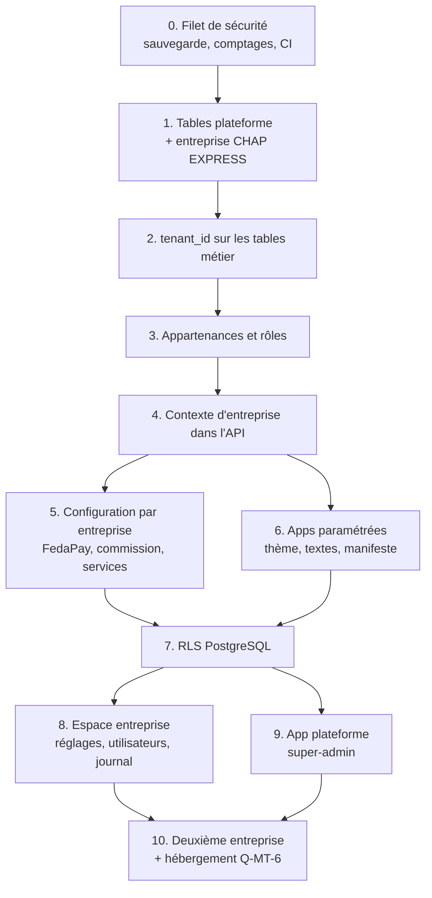

# Plan de migration multi-entreprises (RapidLiv)

> Phase 3 du chantier. S'appuie sur
> [architecture-multi-tenant.md](architecture-multi-tenant.md) (audit,
> architecture cible et décisions du 04/11/2026). Rien n'est encore
> implémenté. Domaine de travail supposé : `rapidliv.com`.

## Principes

1. **Étendre, puis contracter.** Chaque migration ajoute sans rien retirer,
   et reste compatible avec le code de la version précédente. Prisma migre la
   base au démarrage de l'API sur Render (`prisma migrate deploy` dans
   `startCommand`) : l'ancien code tourne encore pendant quelques secondes sur
   la nouvelle base. On ne retire une colonne ou une contrainte qu'une
   version **après** que plus aucun code ne s'en sert.
2. **CHAP EXPRESS par défaut tant qu'il est seul.** Jusqu'à l'étape 10,
   toute requête sans entreprise identifiable retombe sur CHAP EXPRESS. Le
   comportement visible ne change pas, et les PWA déjà installées
   continuent de marcher.
3. **Une étape = un déploiement**, avec critère de sortie, tests et retour
   arrière. On ne commence l'étape suivante qu'une fois la précédente en
   production et vérifiée.
4. **Les tests d'isolation avant le code d'isolation** (étape 4) : ils
   doivent échouer, puis passer.

## Vue d'ensemble



| Étape | Taille | Risque | Visible pour CHAP EXPRESS |
|---|---|---|---|
| 0. Filet de sécurité | S | — | Non |
| 1. Tables plateforme | S | Faible | Non |
| 2. `tenant_id` partout | M | Moyen (volume, unicités) | Non |
| 3. Appartenances et rôles | M | **Élevé** (connexion) | Non |
| 4. Contexte dans l'API | L | **Élevé** (toutes les requêtes) | Non |
| 5. Config par entreprise | M | **Élevé** (paiement) | Non |
| 6. Apps paramétrées | M | Moyen | Non (mêmes valeurs) |
| 7. RLS | M | Moyen (performances) | Non |
| 8. Espace entreprise | M | Faible | Oui, nouveaux écrans admin |
| 9. App plateforme | L | Faible | Non |
| 10. Deuxième entreprise | S | Moyen | Non |

S, M, L sont des tailles relatives (quelques jours, une à deux semaines,
plusieurs semaines pour une personne), pas un engagement.

---

## Étape 0 — Filet de sécurité

**Objectif.** Pouvoir prouver qu'aucune donnée n'est perdue et revenir en
arrière à tout moment.

- `apps/api/scripts/comptages.sql` : nombre de lignes par table, sommes de
  contrôle (`sum(montant_total)`, `sum(montant)` du portefeuille). Exécuté
  avant et après chaque migration, résultats archivés.
- Restauration du `pg_dump` de production (`deploy/sauvegarde.sh`) sur une
  base Neon jetable, **testée une fois** et chronométrée. Même chose avec la
  restauration à un instant donné de Neon.
- Copie anonymisée de la production pour répéter chaque migration avant de
  la jouer en vrai.
- **CI GitHub Actions** (absente aujourd'hui) : typecheck, lint, tests
  unitaires et e2e de l'API sur PostgreSQL de service, tests des 3 apps qui
  en ont. Tout ce qui suit s'appuie dessus.
- Tests d'autorisation manquants **à périmètre constant** (une seule
  entreprise) : un livreur n'ouvre pas la course d'un autre, un client
  n'ouvre pas la commande d'un autre, un restaurant ne voit pas les
  commandes d'un autre. Ils protègent les étapes 3 et 4.

**Sortie.** CI verte sur `main`, restauration testée, comptages de référence
archivés.

**État au 04/11/2026** (branche `multi-tenant`) :

| Élément | État |
|---|---|
| `apps/api/prisma/comptages.ts` (`pnpm --filter @delivero/api comptages`) | Fait, vérifié en local (26 tables ; le mode `--comparer` échoue bien sur une ligne perdue) |
| `apps/api/prisma/anonymiser.sql` | Fait, joué sur une copie locale : tous les utilisateurs anonymisés, aucune ligne métier perdue |
| CI `.github/workflows/ci.yml` | Écrite ; commandes du job rapide vérifiées en local. Premier passage réel au premier push de la branche |
| `apps/api/test/autorisations.e2e-spec.ts` (12 cas : client, restaurant, livreur, sans jeton) | Fait, vert ; suite e2e complète verte (34 tests) |
| Procédure de sauvegarde, répétition, restauration | Écrite dans [deploiement.md § 7](deploiement.md#7-sauvegarde-restauration-et-répétition-dune-migration) |
| Restauration testée sur la vraie base Neon, comptages de production archivés | **À faire** par quelqu'un qui a accès à Neon (je n'y ai pas accès) |

## Étape 1 — Tables plateforme et entreprise CHAP EXPRESS

**Migration** (ajouts uniquement) : `tenants`, `tenant_domains`,
`tenant_settings`, `tenant_features`, `plans`, `subscriptions`,
`tenant_secrets`, `platform_admins`, `audit_logs` (détail dans l'architecture,
§ 2.6).

La migration insère l'entreprise CHAP EXPRESS avec un identifiant fixe
`tnt_chapexpress`, qui sert de valeur par défaut aux étapes suivantes :

- domaines : les 4 domaines Render actuels (`chapexpress-*.onrender.com`)
  et les futurs `chapexpress.rapidliv.com`, `livreur.chapexpress.rapidliv.com`… ;
- réglages : valeurs d'aujourd'hui (couleurs de `marque.css`, contacts de
  `support.ts`, ville Natitingou, XOF, `Africa/Porto-Novo`, +229,
  commission 15 %) ;
- fonctionnalités : reprises de `SERVICES_ACTIFS` et `MODES_PAIEMENT_ACTIFS`
  de production ;
- offre unique « Pilote », sans facturation (Q-MT-5).

**Fichiers.** `prisma/schema.prisma`, une migration, `prisma/seed.ts` (même
entreprise en dev).

**Retour arrière.** Suppression des tables : aucun code ne les lit encore.

**Sortie.** Tables en production, une ligne `tenants`, comptages inchangés.

**État au 05/11/2026** (branche `multi-tenant`, non déployé) :

- Modèles `Tenant`, `TenantDomain`, `TenantSettings`, `TenantFeature`,
  `Plan`, `Subscription`, `TenantSecret`, `PlatformAdmin`, `AuditLog` dans
  `prisma/schema.prisma` ; aucun code ne les lit encore.
- Migration `20261104225343_plateforme_tenants` : création des tables, puis
  insertion de CHAP EXPRESS (`tnt_chapexpress`) avec les valeurs appliquées
  aujourd'hui : couleurs de `marque.css`, numéro de `support.ts`,
  `contact@chapexpress.bj`, Natitingou, XOF, `Africa/Porto-Novo`, +229,
  commission 15 %, services Repas/Colis/Courses express et Mobile Money
  seul, offre « Pilote ».
- Les 4 domaines Render insérés (`chapexpress-*.onrender.com`) sont ceux de
  `render.yaml`, **non vérifiés** : à corriger si Render a ajouté un suffixe.
  Sans effet avant l'étape 4.
- Les fonctionnalités reprennent les valeurs par défaut de la V1. **Si la
  production a d'autres valeurs** de `SERVICES_ACTIFS` ou
  `MODES_PAIEMENT_ACTIFS`, ajuster `tenant_features` avant l'étape 5 (sans
  effet avant).
- Retour arrière : `prisma/retour-arriere/20261104225343_plateforme_tenants.sql`,
  testé en local (suppression puis réapplication).
- Vérifications locales : comptages sans perte sur les 26 tables
  existantes ; `test/plateforme.e2e-spec.ts` (4 cas) ; suites e2e (38) et
  unitaires (60) vertes.

## Étape 2 — `tenant_id` sur les tables métier

**Migration.** Sur les 21 tables métier (architecture § 1.3) :

```sql
ALTER TABLE commandes
  ADD COLUMN tenant_id TEXT NOT NULL DEFAULT 'tnt_chapexpress'
  REFERENCES tenants(id);
CREATE INDEX commandes_tenant_id_idx ON commandes(tenant_id);
```

PostgreSQL ≥ 11 ajoute une colonne avec une valeur par défaut constante
**sans réécrire la table** : toutes les lignes existantes appartiennent
immédiatement à CHAP EXPRESS, sans `UPDATE` long. La valeur par défaut garde
compatible l'ancien code, qui ne connaît pas `tenantId`.

Index composites pour les requêtes fréquentes :
`commandes(tenant_id, created_at)`, `commandes(tenant_id, livreur_id)`,
`livreurs(tenant_id, disponible)`.

**Unicités** (expand puis contract) :

| Version | `zones` / `quartiers` |
|---|---|
| Étape 2 | Ajout de `UNIQUE (tenant_id, nom)`, l'ancienne `UNIQUE (nom)` reste |
| Étape 4 | Le code passe à la clé composite (`admin-zones.service.ts:28`, `seed.ts`) |
| Étape 5 | Suppression de `UNIQUE (nom)` |

`users.telephone` et `users.email` restent uniques (Q-MT-2 : identité
globale). `adresses` reçoit `tenant_id` : une adresse appartient à la personne
**dans une entreprise**.

**Tests.** Comptages identiques ; `SELECT count(*) WHERE tenant_id IS NULL`
= 0 sur chaque table ; suite e2e inchangée et verte.

**Risques.** Verrou bref sur chaque table à l'`ALTER` (quelques
millisecondes, volumes actuels faibles) ; migration jouée d'abord sur la
copie anonymisée.

**Retour arrière.** `DROP COLUMN tenant_id` (migration inverse livrée avec).

**État au 05/11/2026** (branche `multi-tenant`, non déployé) :

- Migration `20261105090000_tenant_id_metier` : 21 colonnes `tenant_id`
  `NOT NULL DEFAULT 'tnt_chapexpress'`, 21 clés étrangères en
  `ON DELETE RESTRICT` (supprimer une entreprise ne peut pas effacer ses
  données), 24 index dont `commandes(tenant_id, created_at)`,
  `commandes(tenant_id, livreur_id)`, `livreurs(tenant_id, disponible)`, et
  `UNIQUE (tenant_id, nom)` sur `zones` et `quartiers` à côté de l'ancienne
  unicité.
- Générée avec `prisma migrate diff` : `migrate dev` refuse de tourner sans
  terminal à cause de l'avertissement sur les nouvelles unicités (sans
  risque ici, tous les noms étant déjà uniques).
- Retour arrière : `prisma/retour-arriere/20261105090000_tenant_id_metier.sql`,
  testé (suppression puis réapplication).
- Vérifications locales : comptages sans perte sur 36 tables, schéma et base
  identiques après migration, `test/plateforme.e2e-spec.ts` vérifie les 21
  colonnes et qu'aucune ligne n'appartient à une autre entreprise ; sur base
  neuve, 45 tests e2e et 60 unitaires verts.
- **En production** : l'ajout de colonne est instantané, mais chaque clé
  étrangère relit sa table pour se valider. Avec les volumes actuels, c'est
  l'affaire de secondes ; à rejouer d'abord sur la copie anonymisée pour
  mesurer.

## Étape 3 — Appartenances et rôles

**Migration.**

- `memberships (user_id, tenant_id, role_id, statut, created_at)`, unique
  `(user_id, tenant_id)`, remplie depuis `users.role_id` pour CHAP EXPRESS.
- Rôles ajoutés au catalogue : `admin_entreprise`, `gestionnaire`,
  `super_admin`. Les comptes `admin_dispatcher` reçoivent une appartenance
  `admin_entreprise`. `admin_entreprise` = permissions actuelles de
  `admin_dispatcher` + paramètres et utilisateurs. `gestionnaire` = les
  opérations sans zones, quartiers, restaurants, remboursements ni réglages.
- `users.role_id` **reste** (lu par l'ancien code), supprimé à l'étape 7.

**Code.**

- `src/auth/roles.ts` : les codes de rôles en constantes, à la place des 79
  littéraux (`'livreur'` ×31, `'client'` ×21, `'restaurant'` ×14,
  `'admin_dispatcher'` ×13) dans 18 contrôleurs et les services.
- `JwtAuthGuard` lit le rôle et les permissions dans **l'appartenance** à
  l'entreprise de la requête (CHAP EXPRESS à ce stade), plus dans
  `users.role_id`. `admin_dispatcher` est accepté comme alias
  d'`admin_entreprise` le temps de la transition.
- Création de compte (`auth.service.ts`, `otp.service.ts`,
  `admin-livreurs.service.ts`, `admin-partenaires.service.ts`,
  `admin-saisie-manuelle.service.ts`) : crée l'utilisateur **et** son
  appartenance. Un numéro qui existe déjà reçoit seulement l'appartenance.

**Tests.** Connexion mot de passe et OTP pour chaque rôle ; un admin garde
tous ses accès ; un livreur sans appartenance est refusé ; inscription d'un
numéro existant.

**Risques.** C'est l'étape qui peut **empêcher de se connecter**. Elle est
déployée seule, un jour calme, avec un compte de chaque rôle testé en
production juste après.

**Retour arrière.** Revenir au code précédent suffit : `users.role_id` est
toujours là et à jour.

**État au 05/11/2026** (branche `multi-tenant`, non déployé ; réalisée
avant l'étape 2, dont elle ne dépend pas) :

- **Écart avec le plan ci-dessus, pour réduire le risque** : aucun rôle n'est
  renommé ni ajouté à cette étape. `admin_dispatcher` reste
  `admin_dispatcher`, parce que l'app admin déjà installée (code en cache)
  n'accepte que ce nom à la connexion. La création d'`admin_entreprise` et de
  `gestionnaire`, et les constantes de rôles (`src/auth/roles.ts`), passent
  à l'**étape 8**, avec l'écran qui gère les utilisateurs et les rôles.
  `super_admin` n'est pas un rôle d'entreprise : c'est la table
  `platform_admins` de l'étape 1.
- Migration `20261104233003_appartenances` : table `memberships`, une
  appartenance CHAP EXPRESS par compte existant, avec le même rôle (78/78 en
  local, aucun rôle divergent).
- `src/auth/appartenance.ts` : entreprise par défaut, rôle effectif
  (appartenance, sinon `users.role_id`), appartenance suspendue = accès
  refusé, y compris pour un jeton déjà émis.
- Le rôle est lu dans l'appartenance par `JwtAuthGuard`, la connexion par mot
  de passe et OTP, et le profil. Les 5 créations de compte (inscription,
  OTP, livreur, restaurant, client saisi par le dispatcher) créent
  l'appartenance ; `seed.ts` et `bootstrap-admin.ts` aussi
  (`assurerAppartenances`).
- Retour arrière : `prisma/retour-arriere/20261104233003_appartenances.sql`,
  testé (suppression puis réapplication) ; redéployer d'abord l'API
  précédente, qui ne lit pas les appartenances.
- `test/appartenances.e2e-spec.ts` (5 cas). Sur une base neuve (migrations
  + seed, comme la CI) : 43 tests e2e verts ; 60 tests unitaires verts.

## Étape 4 — Contexte d'entreprise dans l'API

Le cœur du chantier. Les tests d'isolation (architecture § 4) sont écrits
**en premier**, sur une base e2e à deux entreprises A et B : ils échouent.

**Code.**

| Élément | Fichiers |
|---|---|
| Résolution : en-tête `X-Tenant`, sinon `Host`, puis table `tenant_domains` (cache mémoire 60 s) ; repli CHAP EXPRESS tant qu'il est seul | `src/tenancy/tenant-resolver.middleware.ts` |
| Contexte : `AsyncLocalStorage` `{ tenantId, userId, plateforme }` | `src/tenancy/tenant-context.ts` |
| Jeton : `tid` ajouté au JWT ; un jeton dont `tid` ≠ entreprise du domaine est refusé (403 + événement de sécurité). Les jetons sans `tid` (émis avant le déploiement) valent CHAP EXPRESS jusqu'à leur expiration (2 h) | `auth.service.ts`, `jwt-auth.guard.ts`, `auth-user.type.ts` |
| Extension Prisma : ajoute `tenantId` en lecture (dont `findUnique`, autorisé sur des champs non uniques depuis Prisma 5) et en écriture, sur la liste des modèles métier. Modèle métier sans contexte → erreur | `src/prisma/tenant-extension.ts`, `prisma.service.ts` |
| Client transverse explicite pour la plateforme et les tâches de fond | `src/prisma/prisma-plateforme.service.ts` |
| Tâche de fond : `expiration-paiements.service.ts` (seul `setInterval`) parcourt les paiements tous tenants confondus via le client transverse, puis traite chacun **dans le contexte de son entreprise** | `src/paiements/expiration-paiements.service.ts` |
| Temps réel : `tid` vérifié à la connexion du socket, rooms préfixées `tenant:<id>:user:<id>` | `src/realtime/realtime.gateway.ts` |
| Webhook FedaPay : entreprise retrouvée par le paiement (référence de transaction), jamais par l'en-tête | `src/paiements/paiements.controller.ts` |
| Notifications aux livreurs disponibles : filtrées par entreprise (via l'extension) | `src/notifications/alertes-livreurs.service.ts` |
| CORS : origines lues dans `tenant_domains` en plus de `CORS_ORIGINS` | `src/main.ts` |

Les requêtes brutes : `SELECT 1` (santé) est sans risque ; le verrou
`pg_advisory_xact_lock(hashtext(livreurId))` du portefeuille reste correct,
les identifiants étant uniques globalement.

En fin d'étape, une migration retire la valeur par défaut
`'tnt_chapexpress'` des colonnes `tenant_id` : une écriture sans entreprise
échoue désormais au lieu de tomber chez CHAP EXPRESS.

**Tests.** Toute la grille d'isolation (architecture § 4), plus le test
générique : chaque route authentifiée appelée avec un identifiant de l'autre
entreprise ne renvoie jamais 200. Suites e2e existantes vertes, sans
modification de leurs attentes.

**Risques.** Une requête oubliée par l'extension (modèle absent de la liste),
d'où l'erreur bruyante et la RLS à l'étape 7. Le repli CHAP EXPRESS masque
une mauvaise configuration de domaine : il est **journalisé** à chaque
utilisation, et retiré à l'étape 10.

**Retour arrière.** Code précédent ; remettre la valeur par défaut si la
migration finale a été jouée.

**État au 05/11/2026** (branche `multi-tenant`, non déployé) :

- `src/tenancy/` : contexte `AsyncLocalStorage`, `TenantMiddleware` sur
  toutes les routes, résolution `X-Tenant` → `Origin` → `Host` →
  CHAP EXPRESS (repli journalisé une fois par domaine), cache 60 s ;
  entreprise inconnue → 404, suspendue → 403.
- `src/prisma/extension-tenant.ts`, appliquée au client injecté partout
  (`PrismaService`) : filtre sur 22 modèles (les 21 métier + `Membership`),
  entreprise posée sur chaque écriture, y compris les créations en cascade
  (lues dans `Prisma.dmmf`), jamais de changement d'entreprise par une mise
  à jour ; requête métier hors contexte → erreur.
- Jeton : `tid` ; jeton d'une autre entreprise → 403 et ligne
  `securite.jeton_autre_entreprise` dans `audit_logs`. Un client qui se
  connecte à une nouvelle entreprise y devient client (Q-MT-2), jamais un
  autre rôle.
- Temps réel (salons `tenant:<id>:user:<id>`), webhook FedaPay et
  expiration des paiements (entreprise lue sur le paiement), CORS
  (domaines de `tenant_domains`), seed et `bootstrap-admin`
  (`prisma/client-script.ts`).
- `test/isolation.e2e-spec.ts` : 14 cas sur deux entreprises ; **les 14
  échouent quand on désactive l'extension**, tous passent avec.
- Migration `20261105150000_tenant_id_sans_defaut` : la valeur par défaut
  devient `current_setting('app.tenant_id')`. Une écriture sans entreprise
  échoue (vérifié par un `INSERT` direct) ; les 59 tests e2e passent sans
  elle, preuve qu'aucune écriture de l'API n'en dépendait.
- **Ordre de déploiement : deux mises en production.** D'abord le commit
  « every request scoped to its company » (avec les migrations des étapes
  1 à 3 et 2), vérifié en production ; ensuite seulement le commit de la
  migration `tenant_id_sans_defaut`. Déployées ensemble, l'ancienne API
  encore en service pendant la bascule échouerait à chaque insertion.
- Hors périmètre de cette étape, à faire à l'étape 6 : l'en-tête
  `X-Tenant` envoyé par les apps (en attendant, l'`Origin` des apps et le
  repli CHAP EXPRESS suffisent), et le CORS du temps réel, toujours sur
  `CORS_ORIGINS`.

## Étape 5 — Configuration par entreprise

| Aujourd'hui | Demain | Fichiers |
|---|---|---|
| `SERVICES_ACTIFS`, `MODES_PAIEMENT_ACTIFS` (env) | `tenant_features` ; l'env reste le **plafond** de la plateforme (intersection) | `config/perimetre-v1.service.ts` |
| Commission 15 % en dur | `tenant_settings.taux_commission`, 15 % pour CHAP EXPRESS (valeur actuelle, pas une nouvelle règle) | `commandes-repas.service.ts:207`, et le calcul affiché dans `apps/client/src/pages/CartPage.tsx` |
| Compte FedaPay unique (env) | Un compte par entreprise (Q-MT-4) dans `tenant_secrets`, chiffré AES-256-GCM avec une clé maîtresse en env | `paiements/` |
| Webhook `POST /paiements/fedapay` | `POST /paiements/fedapay/:slug` : la clé de signature à vérifier est celle de l'entreprise. L'ancienne URL reste branchée sur CHAP EXPRESS jusqu'au changement dans le tableau FedaPay | `paiements.controller.ts` |
| Twilio, expéditeur e-mail (env) | Compte plateforme par défaut, surcharge possible par entreprise ; textes avec le nom de l'entreprise | `notifications/`, `auth/otp.service.ts` |
| Dossier Cloudinary `chapexpress/*` | `<slug>/*` | `medias/` |

Suppression de l'ancienne unicité `nom` sur `zones` et `quartiers` (voir
étape 2).

**Tests.** Paiement sandbox de bout en bout pour CHAP EXPRESS avec la clé
déplacée en base ; webhook signé avec la clé de A rejeté pour B ; commission
recalculée identique sur les commandes de test.

**Risques.** Le **paiement** : la bascule de la clé FedaPay de l'env vers la
base se fait en lecture double (base, sinon env) pendant une version. Le
webhook reste accepté sur les deux URL tant que FedaPay n'a pas été
reconfiguré.

**Retour arrière.** Code précédent : l'env n'a pas été vidé.

**État au 06/11/2026** (branche `multi-tenant`, non déployé) :

- `src/tenancy/parametres-tenant.service.ts` : réglages et fonctionnalités
  de l'entreprise de la requête (cache 60 s). Pas de valeur par défaut :
  une entreprise sans réglages ne peut pas chiffrer une commande.
- Périmètre : variables d'environnement = plafond de la plateforme,
  `tenant_features` = ce que l'entreprise ouvre ; il faut les deux.
  Repas, Colis et Courses express vérifient désormais aussi que leur
  service est ouvert (comme Emplettes). Rien ne change pour CHAP EXPRESS.
- Commission : `tenant_settings.taux_commission`, calculée
  `x × (taux / 100)`, identique au franc près à l'ancien `x × 0,15`
  (vérifié de 0 à 2 000 000 FCFA). Le calcul affiché dans l'app client
  (`CartPage`) suit à l'étape 6.
- FedaPay : clés de chaque entreprise dans `tenant_secrets`, chiffrées
  AES-256-GCM avec `TENANT_SECRETS_KEY` ; pour CHAP EXPRESS seulement,
  repli sur `FEDAPAY_*`. Webhook `POST /paiements/webhook/fedapay/<slug>`
  vérifié avec le secret de cette entreprise ; l'ancienne adresse reste
  celle de CHAP EXPRESS. Un webhook signé par une entreprise pour un
  paiement d'une autre est ignoré et journalisé
  (`securite.webhook_autre_entreprise`).
- Adresse de retour du paiement et liens des courriels : domaine principal
  vérifié de l'entreprise ; **CHAP EXPRESS garde `CLIENT_APP_URL` /
  `CLIENT_URL`** tant que ses domaines ne sont pas vérifiés.
- Textes (code SMS, notifications, courriels) au nom de l'entreprise ;
  dossier Cloudinary par entreprise (`chapexpress/` conservé pour CHAP
  EXPRESS, identifiant `tnt_…` pour les autres). Expéditeurs Twilio et
  courriel : ceux de la plateforme pour toutes, pas de surcharge par
  entreprise pour l'instant.
- Migration `20261105180000_unicite_nom_par_entreprise` : suppression de
  l'unicité globale du nom des zones et des quartiers.
- Tests : unitaires (chiffrement, clés FedaPay par entreprise, plafond ∩
  fonctionnalités), e2e (commission de B à 10 %, contre-remboursement
  refusé chez B, webhook croisé ignoré, adresse de webhook inconnue
  refusée). Les e2e ouvrent les fonctionnalités de CHAP EXPRESS le temps
  du passage puis les restaurent (`test/fonctionnalites-e2e.ts`). Base
  neuve : 64 e2e et 71 unitaires verts.
- **À faire en production avant d'ouvrir une deuxième entreprise** :
  générer `TENANT_SECRETS_KEY` (`openssl rand -base64 32`) dans Render ;
  enregistrer les clés FedaPay de chaque nouvelle entreprise (écran de
  l'étape 8) et déclarer `…/paiements/webhook/fedapay/<slug>` dans son
  tableau FedaPay. Pour CHAP EXPRESS, rien d'obligatoire : ses variables
  `FEDAPAY_*` et son adresse de webhook actuelles continuent de marcher.

## Étape 6 — Apps paramétrées

| Élément | Changement |
|---|---|
| `GET /api/tenant` (public) | Nom, logo, couleurs, contacts, ville, devise, fuseau, indicatif, fonctionnalités |
| Client HTTP et socket des 4 apps | En-tête `X-Tenant` d'après `location.hostname` (`apps/*/src/api/client.ts`, `realtime.ts`) |
| Thème | Couleurs de l'entreprise appliquées aux variables CSS de `packages/config/marque.css` au démarrage ; valeurs actuelles en repli |
| Textes | Les 107 « ChapExpress » et 17 « Natitingou » lus dans la configuration ; `support.ts` lit le WhatsApp de l'entreprise |
| Formats | `formatPrixFcfa` et les dates lisent devise et fuseau de l'entreprise |
| Fonctionnalités | `perimetre-v1.ts` reste le plafond compilé ; l'ouverture réelle vient de `/api/tenant` |
| Manifeste PWA | `GET /api/tenant/manifest.webmanifest`, icônes de l'entreprise |
| Hors ligne (livreur) | Configuration mise en cache comme les listes (`cache-persistant.ts`) |

**Tests.** Tests front existants verts ; nouveau test : rendu avec une
configuration B (autre nom, autres couleurs) ; captures avant/après de CHAP
EXPRESS, identiques.

**Risques.** Écran blanc si `/api/tenant` échoue au premier lancement : la
configuration CHAP EXPRESS est embarquée en repli dans le build tant que
CHAP EXPRESS est seul.

**État au 06/11/2026** (branche `multi-tenant`, non déployé) :

- API : `GET /api/tenant` (public) : nom, logo, couleurs, contacts, ville,
  pays, devise, fuseau, indicatif, commission et fonctionnalités réellement
  ouvertes (entreprise ∩ plafond de la plateforme). Ni secret ni domaine.
- `packages/config/entreprise.ts`, partagé par les 4 apps : valeurs CHAP
  EXPRESS par défaut (premier lancement hors ligne), chargement et cache
  local de `/api/tenant`, couleurs appliquées aux variables CSS **seulement
  si elles diffèrent** de celles de CHAP EXPRESS (le thème de `marque.css`
  reste intact), logotype en deux couleurs (`ChapExpress` → Chap +
  Express, tout autre nom d'un seul tenant), lien et numéro WhatsApp du
  support. Paramètre `?entreprise=<slug>` (mémorisé, envoyé en `X-Tenant`)
  pour ouvrir une entreprise en local ou sur un domaine partagé ; sinon
  l'API lit l'`Origin`.
- Apps : nom, ville, support et commission (affichage du panier et du
  détail de commande) lus dans l'entreprise ; services fermés par
  l'entreprise masqués dans l'en-tête, l'accueil et le pied de page du
  client. Les interrupteurs compilés (`perimetre-v1.ts`) restent le
  plafond ; ailleurs, l'API refuse depuis l'étape 5.
- Non modifié volontairement : les clés de stockage local
  (`chapexpress-…`), dont le changement effacerait panier et file hors
  ligne des téléphones ; la devise affichée (FCFA, toutes les entreprises
  prévues sont au Bénin).
- **Reporté à l'étape 10** : le manifeste PWA par entreprise (nom et icône
  installés). Il est généré au build ; le servir dynamiquement change
  l'installation des PWA existantes, à ne faire qu'avec la deuxième
  entreprise et ses domaines.
- Vérifié : capture de l'accueil CHAP EXPRESS identique à celle d'avant ;
  entreprise de démonstration locale (`?entreprise=demo`) affichée avec son
  nom, ses couleurs, sa ville, son support, sans les restaurants des autres
  et sans Courses express. Tests : e2e 67, client 53, livreur 8,
  partenaires 7 ; les 4 apps compilent.
## Étape 7 — Row-Level Security

**Migration.**

- Rôle PostgreSQL `rapidliv_app` **sans** `BYPASSRLS` pour l'API ; rôle
  `rapidliv_plateforme` avec `BYPASSRLS` pour le client transverse ; les
  migrations gardent le rôle propriétaire.
- `ENABLE` + `FORCE ROW LEVEL SECURITY` et politique `tenant_id =
  current_setting('app.tenant_id', true)` sur les 21 tables, une migration
  par lot de tables (commandes et enfants, puis catalogue, puis livreurs et
  portefeuille).
- L'extension Prisma exécute `set_config('app.tenant_id', …, true)` dans la
  transaction de chaque requête.
- Suppression de `users.role_id` (plus lu depuis l'étape 3).

**Tests.** Requête brute sans `app.tenant_id` → zéro ligne ; mesure des
temps de réponse des 10 routes les plus appelées avant/après.

**Risques.** Le coût d'une transaction par requête. Seuil fixé avant la
mise en production : + 20 % au p95 au maximum. Au-delà, regroupement par
requête HTTP (une transaction interactive par requête).

**Retour arrière.** `DISABLE ROW LEVEL SECURITY` par table, sans toucher aux
données.

## Étape 8 — Espace de gestion de l'entreprise

Dans l'app `admin` existante :

- **Réglages** : nom commercial, logo, couleurs (avec aperçu), contacts,
  paramètres de livraison, taux de commission, identifiants FedaPay (saisis,
  jamais réaffichés).
- **Rôles** (reporté de l'étape 3) : création d'`admin_entreprise`
  (permissions actuelles d'`admin_dispatcher` + réglages et utilisateurs) et
  de `gestionnaire` (opérations sans zones, quartiers, restaurants,
  remboursements ni réglages) ; les appartenances `admin_dispatcher`
  deviennent `admin_entreprise`. Les contrôleurs passent de
  `@Roles('admin_dispatcher')` aux permissions, et les codes de rôles en
  constantes (`src/auth/roles.ts`). L'app admin accepte les deux noms une
  version avant le renommage.
- **Utilisateurs et rôles** : inviter, attribuer `admin_entreprise` ou
  `gestionnaire`, suspendre une appartenance.
- **Journal d'activité** : intercepteur global qui écrit dans `audit_logs`
  chaque requête qui modifie des données ; écran filtrable.
- **Clients** : liste des clients de l'entreprise (appartenances `client`).

**Tests.** Un `gestionnaire` ne voit ni réglages ni utilisateurs ; un admin
de A ne lit pas le journal de B.

## Étape 9 — App plateforme (super-admin)

Nouvelle app `apps/plateforme`, même stack et composants, servie sur
`admin.rapidliv.com`, routes API `/plateforme/*` sur le client transverse.

- Entreprises : créer, modifier, suspendre (refuse toutes les requêtes de
  l'entreprise, sauf la lecture par la plateforme), supprimer (exige un
  export préalable).
- Domaines et vérification.
- Offres et fonctionnalités par entreprise, sans facturation (Q-MT-5).
- Statistiques globales : commandes, volume, livreurs actifs par entreprise.
- Journal plateforme et événements de sécurité.
- Création du premier super-admin : script sur le modèle de
  `prisma/bootstrap-admin.ts`.

**Tests.** Un `admin_entreprise` appelle `/plateforme/*` → 403 ; une
entreprise suspendue ne peut plus se connecter ni commander.

## Étape 10 — Deuxième entreprise

- **Hébergement des sous-domaines (Q-MT-6, à trancher ici)** : Render payant
  avec domaine générique `*.rapidliv.com`, ou serveur Caddy de `deploy/`
  avec certificats à la demande.
- Création d'une entreprise de démonstration depuis l'app plateforme, avec
  son compte FedaPay sandbox.
- Recette croisée complète : la grille d'isolation rejouée en production,
  sur CHAP EXPRESS et la démo.
- Suppression du repli « CHAP EXPRESS par défaut » : une requête sans
  entreprise identifiable est désormais refusée.

---

## Tests de non-régression, à chaque étape

- Suites e2e des 4 services, sans modification de leurs attentes.
- Comptages et sommes de contrôle (étape 0) identiques après chaque
  migration.
- Connexion de chaque rôle CHAP EXPRESS en production juste après le
  déploiement.
- Une commande de bout en bout en production (Repas, Mobile Money sandbox
  ou petit montant réel) après les étapes 3, 4, 5 et 7.

## Prochaine étape

Démarrer par l'**étape 0** (filet de sécurité et CI), qui ne modifie ni la
base ni le comportement, puis l'**étape 1**. Je les implémente sur une
branche dédiée, chacune soumise à votre validation avant la suivante.
